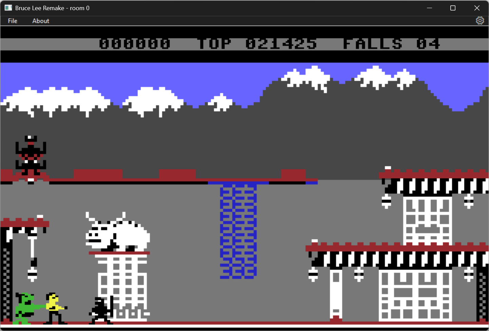
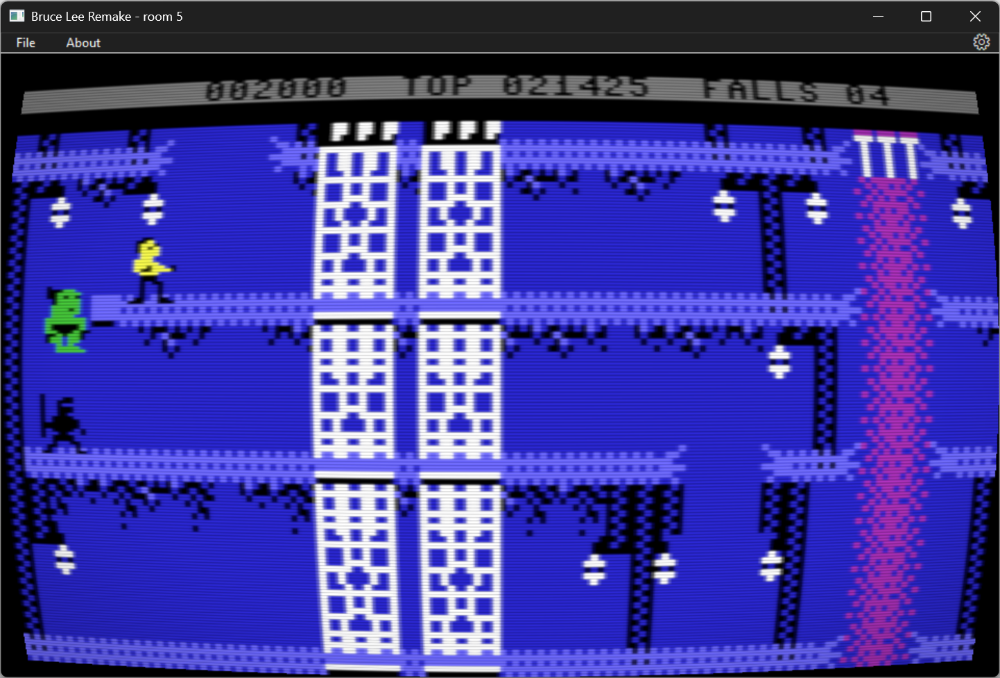

# Bruce Lee

This project recreates the original *Bruce Lee* on the Commodore 64, written natively for Windows with no emulator. It is a homage to the original game and a way to preserve it for the future in source format.

No copyright is claimed over the original game, its pictures, sound, room data, manual, disk image, or box art, and those files are not relicensed by this grant. The Commodore 64 game is copyright 1984 Datasoft, Inc. It was made by Ron J. Fortier, with graphics by Kelly Day and music by John A. Fitzpatrick. This Windows port is copyright Jacob Marner.

This is still a work in progress. The game is now fully feature complete - I just need to fix some bugs before v1.0 release.

Latest release v0.9-beta: (https://github.com/flyingkingbee/BruceLeeRemake/releases/download/v0.9-beta/BruceLeeRemakev0.9.zip)

You can find the original game manual from within the game in the About menu.

## Overview

The game is a C++ rewrite of the original game. Pictures, the room layout, and the collision test come from the original bytes in `data/`. A Windows window, drawn with Direct2D, shows a 320 by 200 screen scaled up with nearest-neighbor filtering. `ShowCRTFilter` draws that same picture as a old school television. Nothing is running inside a Commodore 64 emulator.

The `referencematerial/` contains a copy of the C64 floppy disk image, and a disassembly version of that game (that I comment as I understand the code), and top of that is VICE snapshots from each room. None of the content in this folder are part of the build. It is purely they to help me understand the original game.

| Key | Action |
| --- | --- |
| Space or Enter | Leave the title picture |
| F3 | On the options page, switch 1 player / 2 players |
| F5 | On the options page, switch computer / opponent |
| F7 | Leave the options page |
| L / R | On the options page, set joystick 1 to left-handed or right-handed. Joystick 1 is player 1's keys and the first pad. Left-handed turns the stick a quarter, for holding the joystick sideways: up moves right, right moves down, down moves left, and left moves up. A line on the options page confirms the choice, and during play an L on the top bar shows it. The setting stays until the program closes |
| Shift+L / Shift+R | The same for joystick 2, player 2's keys and the second pad. Its L shows on the top bar only with 2 players or Opponent |
| Left / Right | Player 1 walks. On player 2's turn as Bruce, with Opponent selected, these move Yamo |
| Up | Player 1 jumps. With Left or Right held, jump sideways |
| Down | Player 1 ducks. On a ladder, climb down |
| Right Ctrl | Player 1 punches while standing. Flying kick while moving. Leaves the attract demo |
| W A S D | Player 2. On that player's turn these move Bruce. While player 1 is Bruce and the options page is set to Opponent, they move Yamo. W is up, A is left, S is down, and D is right |
| Left Ctrl | Player 2 punches while standing. Flying kick while moving |
| Space | Pause during play. Press again to resume. As in the original, the current player's fire button (Right Ctrl, Left Ctrl, or A on that player's pad) also resumes |
| V | Show the credit line on the top bar, BRUCE LEE (C) 1984 DATASOFT REV.2 BY RJF. Press again for the black bar. Entering a room brings the black bar back |
| S | During play, switch the options tune off or on. Nothing changes until the next options page: it is silent, or the tune starts as soon as that page opens. Press again to switch it back |
| F1 | Return to the options page. The score, the falls, and the rooms start over. The two option choices stay. Also leaves the attract demo |
| Escape | Leave full screen, and close Settings if it is open |
| F2 | Open the game manual |
| Ctrl+F1 | About |
| Ctrl+, | Settings |
| F6 | Quick save. Saving works during play, paused or not |
| F9 | Quick load. Works from any screen |
| Ctrl+S | Save to one of eight slots. With two players or Opponent selected, use Right Ctrl: Left Ctrl with S is player 2's punch and duck |
| Ctrl+O | Load one of eight slots |
| F12 | Save a picture of the window as the next free ScreenShotXX.png, in the folder the config file was read from. A camera flash shows in the upper right |
| Alt+F4 | Exit |

Leave the options page alone for about 48 seconds and the attract demo starts, as in the original. Bruce stands in room 0 holding every direction and the button while the ninja and Yamo knock him out, then the options page comes back. The demo has no pause and keeps no top score. Right Ctrl, A on the first pad, or F1 ends it.

Double-click anywhere in the window to toggle a borderless full screen. The maximize button turns it on. The Settings window does the same, and Escape leaves full screen. 

You can change settings in `config.ini` or in the settings menu. The program writes the settings back to the file it opened when it closes.

| Xbox control | Action |
| --- | --- |
| A | Leave the title picture. Leave the options page. Punch while standing. Flying kick while moving. On the first pad, leave the attract demo |
| D-pad or left stick | Move. Left and right walk, up jumps, down ducks or climbs |
| D-pad or left stick, up with left or right | Jump sideways |
| Menu | Pause. Press again to resume. A on the current player's pad also resumes |
| View | Open Settings. Press again to close it |
| Y | While paused, hold for 2 seconds to return to the options page. A bar under PAUSED fills while Y is held |

## Saving

File > Save game and File > Load game each list eight slots, and F6 and F9 are a quick save and a quick load in a slot of their own. A slot shows the date and time of its save, the room, and how many times that game has been finished, for example `2026-11-26 14:32   Room 5   Completed 1`. Saving over a slot that is in use asks first. The quick save never asks. Saving works only during play, paused or not. Loading works from any screen, the title and game over included, and play continues exactly where the save was made: the fighters, the room's traps, the score, the other player's turn, and the rest.

The saves are `quick.sav` and `slot1.sav` to `slot8.sav` in a `Saves` folder beside the config file. They are text, in the same style as `config.ini`. A save records every setting, but a load takes back only InfiniteLives, EnemiesCantHitBruce, and FixBugsInOriginal, along with the options page choices (players, opponent, and the handedness of each joystick). Display, sound, gamepads, and the top score stay as they are. Each file has a format number, so a later version of the game can still read it.

## Scoring rules

| Event | Points |
| --- | --- |
| Chopping Ninja or Yamo | 100 |
| Kicking ninja or Yamo | 75 |
| Landing on a fighter | 50 |
| Knocking out the ninja | 200 |
| Knocking out Yamo | 450 |
| Lantern | 125 |
| First time into a room, except room 0 | 2000 |
| Each height band in room 13 | 500 |
| Destroying the wizard | 3000 |

Room 0 never pays. After the treasure room, the other rooms pay 2000 again on the next visit. An extra life is given at 40,000, then every 30,000. The same life counter is what room 16's symbol increments. Past 99 lives the line shows A0, B0, and so on through F9. At 1,000,000 the six digits show 000000 and the total keeps going.

The original game has a bug in a landing that drives the health byte negative. It does not stop at one 50 and one knockout. The game keeps applying that landing until the byte is positive again, so the ninja on 4 health pays 6,550 and is left at 125, and Yamo pays 13,050. A landing that does not cross zero pays 50 once. Set FixBugsInOriginal option to True to fix this. Set it to False to get original scoring.

The original game has a second scoring bug. When the score passes the top score, the game copies four bytes where it should copy three. The extra byte lands on the first extra-life mark that the next game starts from, so that next game's first extra life can come at 105,536, 171,072, or higher instead of 40,000. The value depends on where the screen was being drawn at that moment. It lasts until the program is restarted. FixBugsInOriginal set to True keeps the first extra life at 40,000. False gives the original behavior.

## Correctness of the port

I have seen several poor attempts at making a port of C64 Bruce Lee to other platforms. They all differ from the original in multiple ways. I have made great effort to make this port frame-by-frame accurate and faithful to the orignal.

A suite of 238 regression tests has been made that compares the a play sessions in original with the port to ensure that the port is accurate in every single frame. All tests passes!

## Trivia 

Room 16 has a ying-yang symbol. Picking it up with add an extra life. It will reappear if you leave the room and re-enter. You can get up to 5 extra lives this way. Each player has his own counter. It does not reset when completing the game, so it is 5 lives max for that player for the session.

After completing the game, you will restart in room 0 again. After you complete the game the following will change:
* The Room 13 electric floors moves differently.
* The time to spawn for Ninja and Yamo is reduced.

## TODO before v1.0

* Bug fixing

## TODO after v1.0

* Convert assets to something easier to edit.
* Record/Replay gameplay - set gamespeed
* A level editor
* Option to play with improved graphics/audio

## Building the Source code

`build.bat` compiles with the Visual Studio C++ tools. `build.bat debug` writes `build\Debug\BruceLee.exe` with optimizations off and a program database beside it. `build.bat release`, or `build.bat` with no argument, writes the optimized `build\Release\BruceLee.exe`. `build.bat all` builds both. In Cursor, with the CodeLLDB extension installed, Ctrl+Shift+B builds Debug and F5 launches it under the debugger. The Run and Debug menu can start Release as well.

`DESIGN.md` describes how a frame runs, how the character cells and sprite poses are stored, how collision decides wall and floor, and how the regression tests compare the port with the original game.